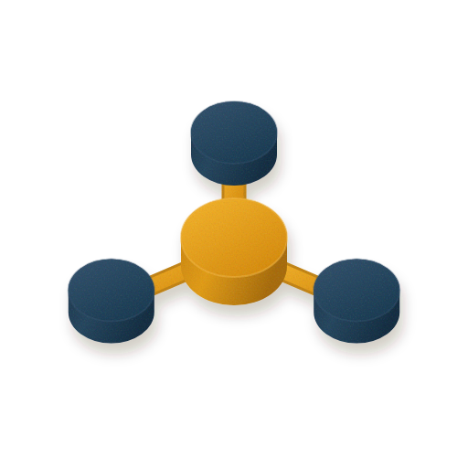

<p align="center">
  
</p>

# Capstan

Capstan is a Laravel application your organisation forks, deploys to its own infrastructure, and runs
for itself. It is not a SaaS product and it is not multi-tenant: one deployment belongs to one
organisation, and you own the server, the database, and the data.

## What it does

Capstan ships three capabilities today. They are available on every installation; artifact hosting
additionally requires a safe second origin before it can accept or render content.

**Artifact hosting.** Your tools `POST` a page of HTML to Capstan and get back a signed, expiring link
they can share. The HTML is stored privately and served from a second hostname that never receives
your login cookie, inside a sandboxed iframe under a strict content security policy. That is how
untrusted AI-generated HTML is made safe here: by isolating it, not by stripping tags out of it.

**Postmaster.** A signed message bus. Command-line agents on your machines poll Capstan once a minute,
announce which inboxes they are ready to receive on, and hand work to each other through addresses
like `build-agent@<server-id>`. Capstan signs every message it delivers and tracks which agents are
alive.

**Work.** A queue of tasks for your agents. You create a task and queue items on it from an MCP client,
and a small drain process on each machine claims an item and starts the command assigned to its role.
The reference drain and its configuration are in [docs/work.md](docs/work.md).

Together they replace the per-seat link-sharing and agent-messaging tools you would otherwise pay for
per person.

## The easy way: Scalpels

[Scalpels](https://scalpels.app/products/capstan) does the setup for you: it forks Capstan, provisions
what it needs on your Laravel Cloud account, and deploys it. The repository and the infrastructure end
up yours either way. The difference is who spends the afternoon on the steps below.

Installed that way, Scalpels fills `CAPSTAN_ARTIFACT_RENDER_ORIGIN` with the environment's own
`laravel.cloud` address. Artifact hosting
still stays off until you add a custom domain in Laravel Cloud, because until then `APP_URL` is that
same `laravel.cloud` address and there is no second host to serve artifact HTML from. Once the domain is
attached, `APP_URL` follows it, the two hosts differ, and artifacts, pages and the brand kit start
working. Remove the custom domain and they fail closed again on their own. Postmaster's signing root is
ensured on every deploy, so there is no key to create by hand. Postmaster and Work are available
immediately; pooled Work remains off for each team until an Owner or Admin enables it.

[Getting started with Capstan via Scalpels](docs/getting-started.md) walks a new team from the install
to its first drained Work item and its first published page.

Running it yourself is free of licence cost; Capstan is MIT licensed. You still pay for the
infrastructure it runs on, and you do the provisioning, deployment and upgrade work described here.

Scalpels: **<https://scalpels.app/products/capstan>**

## Run it yourself

### What you need

| | |
| --- | --- |
| PHP | **8.5 or a later 8.x release.** `composer.json` requires `^8.5`, which excludes PHP 9. |
| Composer | 2.x |
| Node.js | 20.19+ or 22.12+ (required by Vite 8) |
| A database | SQLite for local development; PostgreSQL or MySQL in production |
| For deploying | A [Laravel Cloud](https://laravel.com/cloud) account, the `cloud` CLI, and one or two hostnames you control |

Install and authenticate the Laravel Cloud CLI before the deploy section:

```bash
composer global require laravel/cloud-cli
cloud auth          # opens a browser; writes a token to ~/.config/cloud/config.json
```

**If you want artifact hosting you need a *second* hostname.** Capstan serves the app on one and
artifact HTML on another. Using one hostname for both is not a shortcut: Capstan refuses to serve
artifacts at all rather than give up the separation. Postmaster on its own needs only the app
hostname. Locally you do not need DNS for this (see step 5).

### 1. Fork it, then install it

**Fork <https://github.com/artisan-build/capstan> into your own GitHub organisation first**, and clone
the fork. This is not optional if you intend to deploy: Laravel Cloud builds your application from
whatever `origin` points at, so cloning the upstream repository directly would deploy *our* code from
*our* repository and leave you unable to push a change to it.

```bash
git clone https://github.com/<your-org>/capstan.git
cd capstan
git remote get-url origin     # must print YOUR organisation, not artisan-build
composer setup
```

`composer setup` is the whole local install: it installs the PHP packages, copies `.env.example` to
`.env` if you do not have one, generates an app key, creates a SQLite database and migrates it, then
installs and builds the frontend.

**Run it on a fresh clone only.** It keeps an existing `.env` file, but it always regenerates
`APP_KEY`, so running it in an installation you already use invalidates that installation's
encrypted values and signs everyone out. On an existing checkout run the pieces you need by hand
(`composer install`, `php artisan migrate`, `npm install && npm run build`) and leave `key:generate`
alone.

The migration step prints a long list of tables ending in `DONE`. Most of them belong to Built for
Cloud, the package that provides Capstan's accounts, sign-in and API credentials.

If PHP is too old, it stops with `Root composer.json requires php ^8.5 but your php version (...) does
not satisfy that requirement`. Install PHP 8.5 and try again.

### 2. Run the local checks

```bash
composer ready
```

This formats the code with Pint, type-checks it with PHPStan, then runs the Pest suite. A clean
checkout finishes with every tool reporting `passed` and no PHPStan errors.

`composer ready` is your local preflight, not the full CI gate. CI additionally runs `composer audit`,
checks Pint in `--test` mode (which fails instead of rewriting), migrates a fresh database, and runs
the whole suite a second time against **PostgreSQL**. And the suite deliberately swaps in an in-memory
SQLite database plus `array` cache, `array` session, `sync` queue and `array` mail, so a green run says
nothing about the drivers your deployment actually uses. Check user-visible behaviour in the running
app as well.

### 3. Create the first account

Nobody can sign in yet, and there is no public sign-up page. Create the first account from the command
line:

```bash
php artisan create-admin --local --email=you@example.com --name="Your Name"
```

It asks for a password twice, then prints `Admin user you@example.com created.` Ignore the wording:
the *first* account is always the **Owner**, the one account that can promote and remove admins.
Afterwards the command refuses to run again (`An Owner already exists`) unless you add `--force`, which
creates an Admin.

> ### What `--local` does, command by command
>
> Some Built for Cloud commands can act on your **deployed Laravel Cloud environment** instead of your
> machine. They behave differently, so it is worth knowing which is which:
>
> - **`bfc:credential:*` and `bfc:signing-root:{ensure,provision}` refuse to run without `--local`.**
>   They print an error and exit. You cannot reach production by forgetting the flag.
> - **`create-admin` asks.** With `--local` it acts locally, with `--environment=<env>` it acts on that
>   Cloud environment, and with neither it shows a chooser that defaults to this machine.
> - **`bfc:ownership:mint-claim` and `bfc:ownership:remint-owner-token` do not ask.** Without `--local`
>   they go straight to the Cloud application this checkout is bound to, picking the environment
>   automatically when there is only one.
>
> The habit that keeps you safe is the same either way: **pass `--local` unless you mean production.**

### 4. Start the app

The frontend has to be built before you sign in. `composer setup` builds it; on any other checkout run
this first:

```bash
npm ci && npm run build
```

Without it every signed-in page returns `500` with `Vite manifest not found at
.../public/build/manifest.json`. Then start the app:

```bash
php artisan dev
```

This runs the web server, the queue worker, the Vite dev server and a log tail together, and prints
`Server running on [http://127.0.0.1:8000]`. Sign in at <http://localhost:8000/bfc/login> with the
account from step 3 and you land on the dashboard. There is no `/login` or `/register` page; sign-in
belongs to Built for Cloud and lives under `/bfc`.

Keep this terminal visible. With the default `MAIL_MAILER=log`, mail Capstan sends (invitations in
particular) is written to the log rather than delivered, and the `logs` pane is where you read it.

### 5. Configure artifact isolation and the signing root

Artifacts need a second hostname. Locally, use a `.localhost` subdomain: browsers and
macOS resolve anything under `.localhost` to `127.0.0.1`, so this needs no DNS and no `/etc/hosts`
edit. Both names reach the same dev server; Capstan tells them apart by the `Host` header.

```dotenv
CAPSTAN_ARTIFACT_RENDER_ORIGIN=http://artifacts.localhost:8000
```

Leave `APP_URL` alone. The value `.env.example` ships is already the right one for local work, and
what matters is only that the render origin is a *different* host from it. The render origin
`.env.example` ships is a placeholder that resolves nowhere, so replace it with the `.localhost`
form above. If the two ever name the same host, Capstan refuses artifact ingest and rendering
rather than serving artifacts on the app's own origin.

Postmaster needs the key Capstan signs messages with:

```bash
php artisan bfc:signing-root:ensure --local
```

That prints `Installation signing root is present. No secret was exported.` The key never leaves the
server and cannot be read back, which is the point. Without it Capstan refuses to deliver messages.

`ensure` is safe to run as often as you like, because it creates the root only if there isn't one. (The older
`bfc:signing-root:provision` refuses once a root exists, which is why deploy scripts use `ensure`.)

Work needs no product flag. Setting up a machine drain is covered in [docs/work.md](docs/work.md).
Restart the app after changing `.env`.

### 6. Deploy to Laravel Cloud

> #### Preflight: this clone is already bound to someone else's application
>
> `.cloud/config.json` is committed, and in a fresh clone it holds the **upstream** organisation and
> application IDs. The `cloud` CLI and Capstan's own Cloud-capable artisan commands both read it. If
> you deploy or run one of those commands before rebinding, you are aiming at the upstream
> application, not yours.
>
> ```bash
> cat .cloud/config.json     # whose application is this?
> ```
>
> The binding stays in place through `cloud ship`: `ship` prints the ids it creates but does not write
> this file. **`cloud repo:config`, immediately after, is the command that replaces it.** Until you have
> run that and checked the file, run no other Cloud command from this directory.

The `cloud` CLI is pre-1.0 and its flags move between releases. Confirm any command below with
`cloud <command> -h` before running it.

1. **Create the application and database.**

   ```bash
   cloud ship
   ```

   Answer the prompts: region, application name, this repository, and **let it create and attach a
   PostgreSQL database**. That path attaches reliably, and attaching by CLI flag afterwards does not
   work. Enable the scheduler when it offers: Postmaster's liveness sweep runs every minute.

   `ship` takes the application's repository from this checkout's `origin`, which is why step 1 had you
   clone your fork. Then rebind the local config, because `ship` does not:

   ```bash
   cloud repo:config           # THIS is what rewrites .cloud/config.json
   cat .cloud/config.json      # required checkpoint: the IDs must now be yours
   ```

2. **Create the object storage bucket** (artifact hosting only). Every flag here is required:

   ```bash
   cloud bucket:create --name capstan-production --region <your-app-region> \
     --visibility private --key-name capstan-production --key-permission read_write \
     --allowed-origins "https://<app-host>,https://<render-host>" -n --json
   ```

   `--visibility private` matters: artifacts are served by the app, never from a public bucket URL.
   **Then attach it in the Laravel Cloud dashboard** (Environment → Storage → attach). There is no CLI
   flag for attaching a bucket.

3. **Create the managed queue.**

   ```bash
   cloud managed-queue:create <env> --name capstan --size <size> -n --json
   ```

   Note the `id` in that response. `set-default` takes the **queue instance id** as its only
   argument, not the environment and not the name:

   ```bash
   cloud managed-queue:set-default <instance-id> -n
   ```

   Use a managed queue rather than a worker instance.

4. **Set your environment variables, and only yours.**

   > ⚠️ **Never set an environment variable for something Laravel Cloud provisioned for you.** When
   > you attach a database, cache, queue or bucket, Cloud writes all of its settings (the passwords
   > *and* the connection names like `DB_CONNECTION`, `QUEUE_CONNECTION`, `CACHE_STORE`,
   > `SESSION_DRIVER`, `FILESYSTEM_DISK` and the `AWS_*` keys) into a managed file the app reads. If
   > you set any of them yourself, your value silently replaces Cloud's and the resource stops
   > working. Provision, attach, deploy, and let Cloud fill them in.

   ```bash
   cloud environment:variables --json -n --action=set --key=APP_ENV   --value=production
   cloud environment:variables --json -n --action=set --key=APP_DEBUG --value=false
   cloud environment:variables --json -n --action=set --key=APP_NAME  --value=Capstan
   # plus the CAPSTAN_* keys from the Configuration table
   ```

   Let Cloud generate `APP_KEY`, and **do not set `APP_URL`.** Cloud injects it, and it injects your custom domain once one is attached
   and verified. A value you set yourself shadows that and then stops tracking the domain. `APP_URL`
   matters to artifacts and Postmaster (it names the only page allowed to frame artifacts, and it is
   the base of the poll and token URLs handed to Postmaster agents), so read it back in step 7 rather
   than writing it.

5. **Add your hostnames and point DNS at Cloud.**

   ```bash
   cloud domain:create <env> --name <app-host> --wildcard-enabled=false -n --json
   cloud domain:create <env> --name <render-host> --wildcard-enabled=false -n --json   # artifacts only
   ```

   Each response carries an `id` and a `dnsRecords` array. **Place exactly the records Cloud returns**,
   since that is its statement of what it wants for that hostname right now. Then verify each domain by the
   **id from its own `domain:create` response**, which is the only argument this command takes:

   ```bash
   cloud domain:verify <domain-id> -n --json
   ```

   Once the app hostname is attached and verified, `APP_URL` becomes that hostname on the next
   deploy. You do not have to nominate a primary domain to make that happen, and you do not have to
   set `APP_URL` yourself. Confirm it in step 7.

   **Leave `SESSION_DOMAIN` unset.** If the app and artifact hostnames are neighbours under one domain,
   a shared `SESSION_DOMAIN` hands your login cookie to the artifact origin and removes the isolation
   that makes artifact hosting safe.

   If you put a CDN or proxy in front of the render hostname, it must not rewrite HTML. Capstan sends
   `Cache-Control: no-transform`, which Cloudflare honours.

6. **Deploy and migrate.**

   ```bash
   cloud deploy -n
   cloud deploy:monitor -n
   cloud command:run <env> --cmd "php artisan migrate --force" -n
   ```

   **Do not add `--no-monitor` here.** With it, `command:run` returns as soon as the command has been
   *submitted*, so a failed migration looks like success. Without it, a non-interactive run waits for
   the remote command to finish and reports how it ended. Wait for that result before step 7.

7. **Verify the injected resources actually work.** A green deploy does not prove this; read the
   resolved config out of the running environment:

   ```bash
   cloud tinker <env> --code="echo config('database.default');"        # your database engine, e.g. pgsql
   cloud tinker <env> --code="echo config('queue.default');"           # Cloud's managed queue connection
   cloud tinker <env> --code="echo config('filesystems.default');"     # the disk wired to your bucket
   cloud tinker <env> --code="echo config('app.url');"                 # injected: must be your app hostname
   cloud tinker <env> --code="var_dump(config('session.domain'));"     # must be null
   cloud tinker <env> --code="Storage::put('probe.txt','ok'); echo Storage::get('probe.txt'); Storage::delete('probe.txt');"
   ```

   The storage round-trip is the one that proves the bucket is attached and injected. If any value
   looks wrong, first check whether **you** set a variable shadowing an injected one, and remove it.

8. **Set up the deployed installation.** The accounts you made locally do not exist there.

   ```bash
   # Creates the Owner on <env>. You are prompted for the password here; only its
   # hash is sent. This is the one time you deliberately leave --local off.
   php artisan create-admin --environment=<env> --email=you@example.com --name="Your Name"
   ```

   **Postmaster's signing root needs no step of its own if your deploy ensures it.** Built for Cloud
   v0.19.9 ships `bfc:signing-root:ensure`, which creates the root only when one is missing and is
   therefore safe to run on every deploy. A Scalpels-installed Capstan already does this. If you wrote
   your own deploy commands, add it there:

   ```bash
   php artisan bfc:signing-root:ensure --local
   ```

   To create it once by hand instead, run it inside the environment rather than pointing it at one;
   the verb is local-only by design. No `--no-monitor`: wait for the result, or you will not know the
   key exists.

   ```bash
   cloud command:run <env> --cmd "php artisan bfc:signing-root:ensure --local" -n
   ```

9. **Check the app answers.** `https://<app-host>` should return `200` with a valid certificate, and
   `GET /up` should return `200` once the app has booted.

## Configuration

The settings a self-hosted Capstan normally changes. Laravel's own settings are in `.env.example`.

| Variable | Default | What it does |
| --- | --- | --- |
| `APP_URL` | `http://localhost` | The app's own hostname. It names the only page allowed to frame artifacts, and it is the base of the poll and token URLs handed to Postmaster agents. **On Laravel Cloud, do not set it.** Cloud injects it, and it becomes your custom domain once one is attached and verified. Setting it shadows the injected value and stops it tracking the domain. Read it back (step 7) instead. |
| `CAPSTAN_ARTIFACT_RENDER_ORIGIN` | *(none)* | The second hostname artifact HTML is served from, which must not be the app's own host. **Installed through Scalpels there is nothing to set:** it is filled in with the environment's `laravel.cloud` address, and artifact hosting switches itself on once you add a custom domain in Laravel Cloud, because `APP_URL` follows that domain and the two hosts stop matching. **Self-hosted outside Scalpels:** give it an `https` origin on a hostname different from `APP_URL`'s. With no value, or the app's own host, artifact hosting is off: ingest and viewing both return `404`, the app itself serves normally, and nothing falls back onto the app hostname. |
| `CAPSTAN_ARTIFACT_MAX_CONTENT_BYTES` | `1048576` | Largest artifact accepted, in bytes. Anything bigger is a `422`. |
| `CAPSTAN_ARTIFACT_CSP_SCRIPT_SRC` | *(empty)* | Comma-separated extra sources artifact HTML may load scripts from. Empty means none. |
| `CAPSTAN_ARTIFACT_CSP_STYLE_SRC` | *(empty)* | Same, for stylesheets. |
| `CAPSTAN_ARTIFACT_CSP_IMG_SRC` | *(empty)* | Same, for images. Inline `data:` images are always allowed. |
| `CAPSTAN_SERVER_ID` | *(none)* | This server's permanent address. Leave it blank: Capstan mints one and stores it. Set it only to restore a previous identity after rebuilding a server. |
| `CAPSTAN_POSTMASTER_MAX_INBOUND` | `50` | Most messages returned by one poll. The rest stay queued for the next one. |
| `CAPSTAN_POSTMASTER_MAP_STALE_AFTER_SECONDS` | `300` | How long an agent can go without polling before the map shows it offline. |
| `CAPSTAN_POSTMASTER_PROBE_INTERVAL_SECONDS` | `300` | Minimum gap between liveness challenges to one agent. |
| `CAPSTAN_POSTMASTER_PROBE_TIMEOUT_SECONDS` | `900` | How long an agent has to answer a challenge before it is marked failed. |
| `CAPSTAN_POSTMASTER_PROBE_BACKOFF_SECONDS` | `1800` | How long to wait before challenging an agent that already failed. |
| `BUILT_FOR_CLOUD_PRODUCT` | `Capstan` | The product name reported by the public `GET /bfc/meta` endpoint. |
| `BUILT_FOR_CLOUD_CREDENTIAL_GUARD` | `bfc` | Name of the auth guard credentials resolve through. The default works; change it only if it collides with a guard you added. |
| `MAIL_MAILER` | `log` | Invitation email. While this is `log`, nothing is delivered; the message is written to the log instead. |

## Using it

### Connect this machine

Capstan credentials are bound to one purpose, installation, and person. Capstan declares two purposes:

| Purpose | Used for |
| --- | --- |
| `capstan.artifact.ingest` | `POST /api/v1/artifacts` |
| `capstan.machine` | Polling, replacement, and Work claim, renew, and transition |

Sign in, open `/postmaster`, and press **Generate installer** under **Connect a local agent**. Run the
one-line command on the machine you want to connect, then approve the waiting request in the same browser.
The person who approves becomes the machine's owner. The installer writes the bound machine credential to
`~/.config/capstan/<server-id>/token` and its non-secret owner id to the adjacent `actor-id` file, both with
mode `0600`. The poller and reference Work drain use those same files; there is no separate drain token.

Do not copy the bearer into a shell variable, configuration field, or chat. Point software at the installed
credential file. When preparing a Work drain JSON config, copy the contents of `actor-id` as the quoted JSON
scalar `actor_id` and set `credential_file` to the installed `token` path. See [docs/work.md](docs/work.md).

### Publishing an artifact

The usual path is the `publish_page` MCP tool, which handles authorization without exposing a bearer.
Direct API integrations use a separately bound `capstan.artifact.ingest` device credential and send the
owner id in `X-Capstan-Actor-ID`; a machine credential is deliberately rejected at this endpoint.

A success is `201` with the artifact and a link to share:

```json
{
  "artifact": {
    "id": "01a0ccd2-1b76-701b-b112-4a45af7329a9",
    "actor_id": "1",
    "visibility": "signed_url",
    "expires_at": null,
    "content_type": "text/html",
    "size_bytes": 61,
    "content_hash": "adc6f946144285907fb73c6f6358f8701ae6ff79da7975afa2f40627e236383a",
    "share_url": "http://localhost:8000/artifacts/01a0ccd2-.../share?expires=...&signature=...",
    "created_at": "2026-09-23T05:51:56.000000Z"
  },
  "share_url": "http://localhost:8000/artifacts/01a0ccd2-.../share?expires=...&signature=..."
}
```

Open `share_url` in a browser. You get a page on the app hostname holding a sandboxed iframe, and the
iframe loads your HTML from `artifacts.localhost:8000` under a content security policy that by default
permits inline scripts and styles and `data:` images, and blocks the page from reaching the network at
all. It can load an external script, stylesheet or image only from a source you add yourself
through the `CAPSTAN_ARTIFACT_CSP_*` variables. Fonts remain blocked by `font-src 'none'`.

The request takes four fields.

- `content`: the HTML. **Required.**
- `content_type`: `text/html` or `application/xhtml+xml`. **Required.**
- `visibility`: `org_auth` (default; anyone signed in to this Capstan can open it) or `signed_url`
  (anyone holding the link can open it, signed in or not).
- `expires_at`: an ISO-8601 time in the future. After it, the link returns `404`.

Application errors share one shape, so you can read `error.code`:

```json
{"error":{"code":"unauthenticated","message":"Unauthenticated."}}
```

You will see `401 unauthenticated` for a missing, wrong or mismatched token, `422 validation_failed`
with a per-field `errors` object for bad input, and `404` when no safe artifact render origin is configured.

**One exception: rate limiting.** You get 60 API requests per minute, counted per person across both
endpoints together. The 61st is rejected by Laravel's throttle middleware before Capstan sees it, so
it is a plain `429` with `Retry-After` and `X-RateLimit-*` headers and **no `error.code`**. Handle that
separately.

### Page layouts and brand CSS

Each immutable page version selects `report`, `dashboard`, `brief`, or `plain`. Report uses
document spacing, dashboard uses tighter padding, and brief uses a smaller document inset.
The first three wrap the body in `capstan-page` and `capstan-layout-report`,
`capstan-layout-dashboard`, or `capstan-layout-brief`, with a `capstan-content` main section.
Optional chrome uses `capstan-header` and `capstan-footer`. Plain adds no shell, header, or footer.
Tokens, component rules, and custom CSS remain available in plain pages. Original body bytes stay
intact inside the shell. Fragments are wrapped; incomplete documents without a closing body retain
their structure instead of guessing where to close a shell.
HTML templates and scripts containing comment-open tokens also omit the shell and chrome;
their parser states are outside the byte-preserving layout scanner.

The installation brand has a `default_layout` of `report`, empty `header_html` and `footer_html`,
and empty `custom_css` until configured. A version's explicit layout always wins. The default is
captured by the publisher when its caller supplies no layout; the publish MCP tool still requires an explicit choice.
Existing applied snapshots receive these defaults without rewriting their stored version.

Chrome partials pass through an HTML5 sanitizer and are stored as deterministic XML-compatible
fragments, at most 32,768 Unicode characters each. Element and attribute names are case-insensitive.
Comments, declarations, processing instructions, custom elements, namespace declarations, and anything
outside the allowlists are rejected instead of removed.

Malformed input that uses only allowed names is repaired by the HTML5 parser and stored in canonical
form. For example, `<div/>x</div>` is stored as `<div>x</div>`. A repair is refused if it drops any
non-whitespace text or allowed start tag seen in the input. A successful draft write returns the stored
canonical header and footer. Its non-persisted `normalized` flag is `true` when either supplied chrome
field changed during canonicalization and `false` when supplied chrome was already canonical.

The element allowlist is `a`, `abbr`, `address`, `article`, `aside`, `b`, `bdi`, `bdo`, `blockquote`,
`br`, `caption`, `cite`, `code`, `col`, `colgroup`, `dd`, `del`, `details`, `dfn`, `div`, `dl`, `dt`,
`em`, `figcaption`, `figure`, `footer`, `h1`, `h2`, `h3`, `h4`, `h5`, `h6`, `header`, `hr`, `i`,
`img`, `ins`, `kbd`, `li`, `main`, `mark`, `nav`, `ol`, `p`, `pre`, `q`, `rp`, `rt`, `ruby`, `s`,
`samp`, `section`, `small`, `span`, `strong`, `sub`, `summary`, `sup`, `table`, `tbody`, `td`, `tfoot`,
`th`, `thead`, `time`, `tr`, `u`, `ul`, `var`, and `wbr`. The attribute allowlist is `class`, `id`,
`role`, `aria-*`, `alt`, `title`, `width`, `height`, `lang`, `dir`, and `style`, plus `href` only on
`a` and `src` only on `img`. An anchor URL must be HTTPS or a non-empty document fragment. An image
URL must be a valid `data:image/...` URI or one of the image UUIDs selected in the same brand kit.
Arbitrary `data-*` attributes, event handlers, and every other URL-bearing attribute are rejected.

Custom CSS is bounded to 65,536 characters. Chrome and CSS accept only XML-compatible UTF-8 without
NUL bytes. CSS accepts local rules and declarations; it rejects markup delimiters, backslash escapes,
comments, at-rules (including imports), and resource functions, including data URLs. Allowed functions
are `var`, `rgb`, `rgba`, `hsl`, `hsla`, `calc`, `min`, `max`, `clamp`, `repeat`, and `minmax`. Inline
`style` attributes use the same CSS grammar. Origin isolation and CSP still contain the whole rendered
page. Drafts do not affect a served page or download until applied.

The component stylesheet is inlined on HTML and XHTML render responses. Its public classes are:

| Classes | Use |
| --- | --- |
| `capstan-page`, `capstan-layout-report`, `capstan-layout-dashboard`, `capstan-layout-brief` | Application-owned page shells |
| `capstan-content`, `capstan-header`, `capstan-footer` | Body and optional chrome sections |
| `capstan-card`, `capstan-grid` | Bordered cards and a responsive card grid |
| `capstan-stat`, `capstan-stat-value`, `capstan-stat-label` | Metric tile, value and label |
| `capstan-table` | Table surface, text and cell spacing |
| `capstan-badge`, `capstan-badge-success`, `capstan-badge-warning`, `capstan-badge-danger` | Badge base and semantic colours |
| `capstan-callout`, `capstan-callout-success`, `capstan-callout-warning`, `capstan-callout-danger` | Callout base and semantic border colours |
| `capstan-chart-series-1`, `capstan-chart-series-2`, `capstan-chart-series-3`, `capstan-chart-series-4`, `capstan-chart-series-5` | Matching text, SVG fill and stroke for each chart series |

Use a base class with its semantic modifier. Appearance values come from normalized
`--capstan-color-*`, `--capstan-space-*`, `--capstan-radius-*`, and `--capstan-font-*` variables.
Page content can bring its own CSS. Applying a brand updates existing pages without publishing
another page version. Custom HTML and CSS never enter the app-host viewer or mail.

Owner export uses the current page version's layout and the current applied brand. It inlines tokens,
components, custom CSS, chrome, and selected brand images as data URLs. Unresolved Capstan dependencies
(including build assets or unselected brand images) cause an opaque refusal rather than a download
that calls back to the installation. After selected images are inlined, the exporter runs the applied
header and footer through the same chrome sanitizer and refuses the download if parsing, validation, or
canonicalization changes either fragment. The exporter never fetches remote resources.

### Connecting an agent to Postmaster

Sign in, open **/postmaster**, and under **Connect a local agent** press **Generate installer**.
Capstan prints a shell snippet containing this server's address, the poll URL and a one-time
authorisation code. It expires in ten minutes, and the page shows when.

Copy it, run it on the machine you want to connect, and approve the request in the browser tab it
opens. It stores a token, writes a poll script under `~/.config/capstan/<server-id>/`, and installs a
once-a-minute cron entry. It needs `curl`, `php` and `crontab` on that machine.

**The installed poller only announces presence and answers liveness probes.** Out of the box it
advertises no inboxes, sends nothing, and acknowledges nothing. It will go green on the map and carry
no mail. To receive messages, give it an address:

```bash
# on the agent machine; <server-id> is the directory the installer created
echo '["build-agent"]' > ~/.config/capstan/<server-id>/inboxes.json
```

The next poll claims `build-agent@<server-id>` for you and advertises it from then on. Inboxes are
first-come: the first user to claim a local part owns it, and another user's agent asking for it gets
`409 inbox_claimed`.

Sending and acknowledging are yours to write. A poll is one `POST /api/v1/poll`; the client reads the
installed `token` and `actor-id` files and sends them in the authorization and actor headers. The same
request can advertise presence, send, and acknowledge at once:

```json
{
  "presence": {"ready_inboxes": ["build-agent", "deploy-agent"]},
  "outbound": [{
    "id": "01ARZ3NDEKTSV4RRFFQ69G5FAV",
    "type": "handoff",
    "version": 1,
    "from": "build-agent@<server-id>",
    "to": "deploy-agent@<server-id>",
    "created_at": "2026-09-23T06:00:00Z",
    "message_id": "01ARZ3NDEKTSV4RRFFQ69G5FAW",
    "body": {"task": "ship it"},
    "refs": []
  }],
  "acks": ["<message_id you have finished with>"]
}
```

`type` must be one of `handoff`, `kb_nomination`, `solicitation` or `generic`; anything else is a `422`.
You may only send `from` an inbox you have advertised at least once, so the sending address belongs in
`ready_inboxes` too. Never send a `signature` yourself: the server signs on delivery and rejects your
version. `refs` must be an empty array in version 1, and `created_at` is UTC to the second.

The response carries `inbound` and `cursor`. Each inbound envelope comes back with the server's
`signature` added (a 64-character hex HMAC) and keeps being redelivered on every poll until you name
its `message_id` in `acks`. After that it stops.

The wire format, inbox ownership rules, request caps and probe protocol are in
[docs/postmaster.md](docs/postmaster.md).

### Inviting the rest of your team

Sign in as Owner or Admin, open **/bfc/members**, and invite an email address. Owners and Admins can
invite Members; only an Owner can invite an Admin.

With the default `MAIL_MAILER=log` nothing is emailed. The members page lists the pending invitation
but **does not show its link**. The message is written to the log instead, so find it there:

```bash
grep -o 'http[^ ]*/bfc/invitations/[A-Za-z0-9_-]*' storage/logs/laravel.log | tail -1
```

Send that link to the person yourself. Opening it leads to an acceptance form; once they submit it,
they appear in the members list as active with the role you chose. To deliver invitations properly,
configure a mailer (see [docs/email-cloudflare.md](docs/email-cloudflare.md)).

## Troubleshooting

**The install stops because PHP is too old.** Capstan requires PHP 8.5. Check with `php -v`; if you
manage several versions, make sure the 8.5 binary is the one on your `PATH`.

**A machine API token returns `401`.** Reconnect it from `/postmaster`; machine endpoints accept only the
installer's `capstan.machine` credential. Check that the request reads both the token and actor id from the
same `~/.config/capstan/<server-id>/` directory. Capstan rejects mismatched ownership before reading the body.

**Artifact links return `404`, or `POST /api/v1/artifacts` returns `404`.** Common causes, roughly in
order: `CAPSTAN_ARTIFACT_RENDER_ORIGIN` is empty or names
the same host as `APP_URL`; the artifact has expired or the id is wrong; or you are requesting artifact
*content* from the app hostname. Content is served only from the render hostname and the viewer page
only from the app hostname. Each refuses the other's host deliberately, so both names must resolve
before artifacts work, including locally.

Without a usable second host the artifact boundary reports itself **unavailable**, so ingest refuses rather than
accept artifacts it could never serve. On Laravel Cloud with no custom domain yet, that is the expected
state and not a misconfiguration: add the domain and artifacts begin working without touching `.env`.

**Artifact HTML arrives rewritten, or with extra bytes.** A CDN or proxy in front of the render
hostname is editing it. Capstan sends `Cache-Control: no-transform`, which Cloudflare honours; if you
have another proxy, turn off its HTML rewriting for that hostname.

**Postmaster messages are never delivered.** The signing root is missing. Capstan signs every envelope
as it hands it over and refuses rather than deliver an unsigned one. Run
`php artisan bfc:signing-root:ensure --local`, or inside a deployed environment as shown in step 8. A
deploy that ensures the root (as a Scalpels install does) should make this impossible.

**The app refuses to boot with Postmaster on**, saying `Postmaster requires app.timezone to be UTC`.
Something changed `timezone` in `config/app.php`. Put `'UTC'` back. Message signatures are computed
over UTC timestamps, so any other timezone silently breaks every signature.

**An agent shows red or pending on the map.** Work down this list:

1. **Is it polling?** Red comes first from poll recency: an agent that has never polled, or has not
   polled within `CAPSTAN_POSTMASTER_MAP_STALE_AFTER_SECONDS` (default five minutes), is red whatever
   its probe says. Check `crontab -l` on the agent machine, then run its poll script by hand and read
   the error: a bad token or an unreachable host fails silently under cron.
2. **Has it answered a challenge?** An agent that polls but has not yet answered one shows **pending**,
   not red. That is normal for a new agent; it turns green after the first successful probe.
3. **Did a probe fail?** A wrong digest turns the agent red even while it polls happily. The failure is
   logged server-side.
4. **Only then, the scheduler.** `postmaster:probe-sweep` runs every minute and is what fails an
   *overdue* probe. If nothing ever moves out of pending, check that the scheduler is enabled on the
   server.

**An invitation was sent but nobody received it.** With `MAIL_MAILER=log` that is the designed
behaviour. Read the link out of `storage/logs/laravel.log` as shown above.

**`php artisan serve` behaves differently from the tests.** `serve` only passes through some
environment variables, so it can use a different database than you expect. Prefer `php artisan
dev`.

## More documentation

- [docs/getting-started.md](docs/getting-started.md): getting started with Capstan via Scalpels, from
  the install to a first drained Work item and a first published page.
- [docs/work.md](docs/work.md): the Work drain: configuration, recovery and limits.
- [docs/built-for-cloud.md](docs/built-for-cloud.md): how accounts, sign-in and API credentials work.
- [docs/postmaster.md](docs/postmaster.md): the Postmaster wire contract, in full.
- [docs/email-cloudflare.md](docs/email-cloudflare.md): sending invitation email.

## License

MIT. See [LICENSE](LICENSE).
